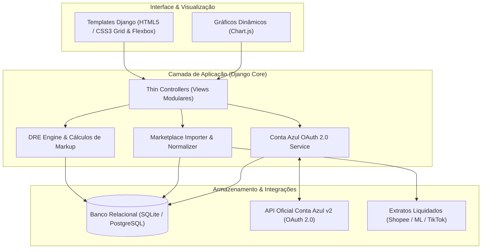

# Lumina ERP — Gestão Fabril Têxtil & Inteligência Multi-Marketplace

[](https://www.python.org/)
[](https://www.djangoproject.com/)
[](https://oauth.net/2/)
[](https://www.sqlite.org/)
[]()
[]()

> **Sistema integrado de engenharia de manufatura, DRE gerencial multi-marketplace e conciliação financeira automatizada via OAuth 2.0.**

---

## 📌 Visão Geral & Problema de Negócio

Indústrias de confecção de vestuário que vendem diretamente em múltiplos marketplaces (Shopee, Mercado Livre, TikTok Shop) enfrentam um desafio crônico: **a desconexão entre o chão de fábrica, as taxas das plataformas de e-commerce e o fluxo de caixa oficial.**

Geralmente, as fábricas não sabem com precisão:
1. Quanto cada produto realmente custou para ser fabricado (tecido, aviamentos, corte, costura interna e facções terceirizadas).
2. Quanto as taxas variáveis dos marketplaces (comissões, fretes de devolução, campanhas de Ads) estão comendo da margem real.
3. Se o lucro da operação vem da eficiência fabril ou da margem comercial do canal de venda.

O **Lumina ERP** resolve esse problema unificando o controle produtivo, o DRE gerencial das lojas virtuais e a conciliação bancária em uma arquitetura limpa, escalável e de alta precisão contábil.

---

## 🏗️ Arquitetura do Sistema

O projeto adota os princípios do **12-Factor App**, separação estrita de responsabilidades e padrões de **Service Layer** para evitar controladores sobrecarregados (*Thin Views, Rich Domain Models*).



---

## 🚀 Principais Funcionalidades

### 1. 🏭 Engenharia de Produção & Cronoanálise Têxtil
* **Ficha Técnica Detalhada:** Consumo paramétrico de matéria-prima (kg de malha, metros de renda, elásticos, bojos e fechos) com recálculo automático em cascata.
* **Ordens de Corte com Matriz de Grade:** Planejamento por tamanho (P, M, G, GG), aproveitamento de tecido e cálculo do custo unitário do cortador.
* **Gestão de Facções Externas & Células Internas:** Rastreamento de sub-lotes enviados para oficinas terceirizadas, prazos de retorno, controle de peças costuradas e liquidação de mão de obra.

### 2. 📊 DRE Gerencial & Inteligência Multi-Marketplace
* **Demonstrativo de Resultado do Exercício (DRE) em Tempo Real:** Consolidação de Receita Bruta, Comissões Retidas, Taxas de Transação, Fretes, Impostos e Lucro Líquido Real.
* **Auditoria de Pedidos:** Extrato cronológico detalhado por canal com status de liquidação e margem de contribuição percentual por pedido.
* **Gestão de Performance Ads:** Monitoramento de ROAS, impressões, cliques e custo de publicidade (Shopee Ads, Mercado Ads, TikTok Ads) integrado ao DRE do produto.

### 3. ⚖️ Janela de Lucro Integrado (Fábrica + Marketplace)
* **Preço de Transferência vs. Custo Fabril:** Mapeamento que permite à diretoria enxergar separadamente:
  * **Janela 1 (Resultado Integrado):** O faturamento total somado e a margem global da operação.
  * **Janela 2 (Performance Fabril):** Quanto a fábrica faturou "vendendo" a peça para a própria loja online ao preço de custo industrial.

### 4. 💳 Conciliação Financeira & OAuth 2.0 (Conta Azul)
* **Fluxo de Autenticação Oficial:** Client credentials com troca de código temporário (`code`) por `access_token` e `refresh_token` permanente.
* **Sincronização Bidirecional:**
  * Envia contas a pagar geradas pelo chão de fábrica (cortes, facção, insumos).
  * Puxa automaticamente despesas fixas e contas a receber bancárias do ERP oficial para conciliação.
* **Layout Responsivo:** Extrato sem barra de rolagem horizontal, com quebra inteligente e formatação padronizada.

---

## 🛠️ Tecnologias Utilizadas

* **Linguagem:** Python 3.12+
* **Framework:** Django 5.x
* **Frontend:** Vanilla HTML5, CSS3 Moderno (Custom Properties, Flexbox, Grid), JavaScript (ES6+), Chart.js
* **Processamento de Dados:** OpenPyXL, Pandas, Python-Decouple
* **APIs & Protocolos:** RESTful, OAuth 2.0 com PKCE / Basic Auth, Requests
* **Deploy & Containers:** Docker, Docker Compose

---

## ⚡ Como Executar o Projeto Localmente

O projeto inclui um **comando de inicialização automática de dados de demonstração**, permitindo que qualquer avaliador teste a aplicação completa em menos de 2 minutos.

### Opção A: Execução Padrão (Python)

1. **Clone o repositório:**
   ```bash
   git clone https://github.com/SEU_USUARIO/NOME_DO_REPO.git
   cd NOME_DO_REPO
   ```

2. **Crie e ative o ambiente virtual:**
   ```bash
   python -m venv venv
   # No Windows:
   venv\Scripts\activate
   # No Linux/Mac:
   source venv/bin/activate
   ```

3. **Instale as dependências:**
   ```bash
   pip install -r requirements.txt
   ```

4. **Execute as migrações e popule o banco de dados de demonstração:**
   ```bash
   python manage.py migrate
   python manage.py seed_demo_data
   ```

5. **Inicie o servidor:**
   ```bash
   python manage.py runserver
   ```
   Acesse **[http://127.0.0.1:8000](http://127.0.0.1:8000)**  
   * **Usuário:** `admin`  
   * **Senha:** `admin123`

---

### Opção B: Execução via Docker (1 Comando)

```bash
docker compose up --build
```
O container aplicará as migrações, gerará a base fictícia e disponibilizará o sistema em `http://localhost:8000`.

---

## 🧪 Testes Automatizados

Para rodar a suíte de testes unitários:

```bash
python manage.py test fabrica
```

---

## 📄 Licença

Distribuído sob a licença **MIT**. Veja `LICENSE` para mais detalhes.

---

**Desenvolvido por Wagner Ferraz** — *Engenharia de Software & Soluções ERP.*
